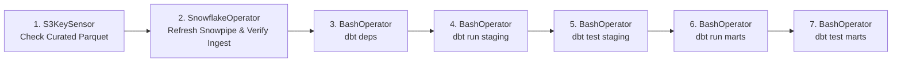

# FundLens Apache Airflow Orchestration

This folder contains the **Apache Airflow** orchestration layer for FundLens, automating the daily end-to-end Medallion data lifecycle across **AWS S3, Snowflake, and dbt**.

---

## 1. DAG Architecture & Execution Pipeline

The primary DAG is [fundlens_daily_elt_pipeline.py](dags/fundlens_daily_elt_pipeline.py):



### Schedule & Timing
- **Schedule Interval**: `30 16 * * 1-5` (Cron: Monday through Friday at **10:00 PM IST / 16:30 UTC**).
- **Rationale**: AMFI publishes official NAV data after domestic market close (~9:00 PM IST). Running at 10:00 PM IST guarantees full multi-fund availability and historical backfill completion.

---

## 2. Quick Start: Local Airflow Cluster via Docker

### Step 1: Initialize Environment
```bash
cd data-platform/airflow

# Create .env from template
cp .env.airflow.example .env
```

### Step 2: Launch Airflow Stack
```bash
docker-compose -f docker-compose.airflow.yml up -d
```
This spins up:
- **PostgreSQL**: Metadata database.
- **Airflow Webserver**: Available at `http://localhost:8080` (Default credentials: `admin` / `admin`).
- **Airflow Scheduler**: Continuous cron monitor and execution engine.
- **Auto-installed Python dependencies**: `dbt-snowflake`, `apache-airflow-providers-snowflake`, `astronomer-cosmos`.

---

## 3. Airflow Connection Configuration

In the Airflow UI (**Admin &rarr; Connections**), add the following two connections:

### 1. Snowflake Connection (`snowflake_fundlens`)
- **Connection Id**: `snowflake_fundlens`
- **Connection Type**: `Snowflake`
- **Account**: `<YOUR_ACCOUNT_ID>.ap-south-1`
- **Login**: `FUNDLENS_DEV_USER`
- **Password**: `<YOUR_PASSWORD>`
- **Database**: `FUNDLENS_DW`
- **Warehouse**: `FUNDLENS_WH`
- **Role**: `FUNDLENS_TRANSFORMER_ROLE`
- **Schema**: `SILVER`

### 2. AWS Connection (`aws_default`)
- **Connection Id**: `aws_default`
- **Connection Type**: `Amazon Web Services`
- **AWS Access Key ID**: `<YOUR_AWS_ACCESS_KEY_ID>`
- **AWS Secret Access Key**: `<YOUR_AWS_SECRET_ACCESS_KEY>`
- **Extra**: `{"region_name": "ap-south-1"}`

---

## 4. Running & Monitoring

1. Open the Airflow Webserver at `http://localhost:8080`.
2. Toggle the `fundlens_daily_elt_pipeline` DAG to **Active (Unpaused)**.
3. Trigger a manual test run by clicking the **Play (Trigger DAG)** button.
4. Inspect execution logs for each task:
   - `check_s3_curated_landing` verifies today's Parquet files in S3.
   - `verify_snowpipe_sync` triggers and confirms Snowflake micro-batch ingestion.
   - `dbt_run_staging` & `dbt_test_staging` clean raw data into Silver views.
   - `dbt_run_marts` & `dbt_test_marts` incrementally merge facts and refresh star-schema data marts.
