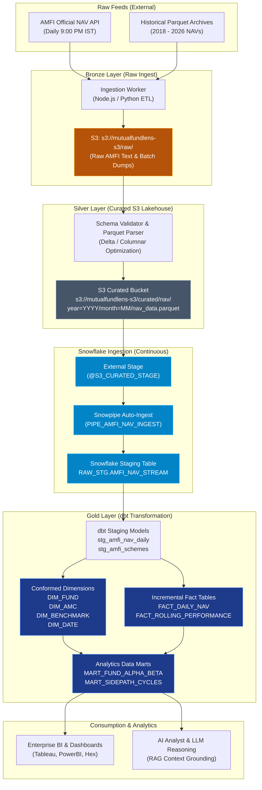

# FundLens Enterprise Data Platform Architecture
## Medallion Lakehouse with dbt, Curated S3, and Snowflake

This document outlines the enterprise-grade data platform architecture for FundLens. It details the end-to-end data lifecycle from raw regulatory ingestion (AMFI NAV feeds) to high-performance analytical data marts in Snowflake, driven by dbt (data build tool).

---

## 1. Executive Summary & Design Principles

| Pillar | Architecture Specification |
|---|---|
| **Architecture Pattern** | Medallion Lakehouse (Bronze &rarr; Silver &rarr; Gold) |
| **Ingestion Engine** | Python / Async Node ETL worker + AWS S3 Event Notifications |
| **Storage Tier** | AWS S3 (curated partitioned Parquet columnar format) |
| **Warehouse Tier** | Snowflake Enterprise Data Cloud (Virtual Compute & Micro-partitions) |
| **Transformation Layer** | dbt (data build tool) via `dbt-snowflake` |
| **Data Modeling** | Kimball Star Schema (Conformed Dimensions + Incremental Merge Facts) |
| **Continuous Integration** | GitHub Actions Automated Ingestion & dbt Data Quality Contracts |

### Core Architectural Principles:
1. **Decoupled Compute and Storage**: Raw and curated analytical datasets are persisted in AWS S3, enabling cost-effective tiered storage independently of warehouse compute.
2. **Idempotency & Zero Duplicate Records**: Fact models use dbt incremental merge strategies keyed on natural business keys (`(scheme_code, nav_date)`).
3. **Decoupled from Application SSR**: The operational frontend application and nightly S3 snapshot engine remain isolated from the analytical warehouse, preventing analytical query loads from impacting user-facing latencies.
4. **Data Contract & Governance**: Strict schema enforcement, dbt tests (`unique`, `not_null`, referential integrity), and metadata lineage tracking.

---

## 2. End-to-End Data Lineage & Flow



---

## 3. Storage Hierarchy & S3 Partitioning Strategy

Curated Parquet files are written to S3 using Hive-style directory partitioning to optimize object-level pruning and Snowflake external stage scan performance:

```text
s3://mutualfundlens-s3/
├── raw/                                     # Bronze: Untransformed source dumps
│   └── amfi/
│       └── YYYY-MM-DD/
│           └── NAVAll.txt
│
├── curated/                                 # Silver: Clean, typed, columnar Parquet
│   ├── nav/                                 # Partitioned daily NAV records
│   │   └── year=2026/
│   │       ├── month=01/
│   │       ├── ...
│   │       └── month=09/
│   │           └── part-0000.parquet
│   │
│   ├── scheme_metadata/                     # Master scheme metadata snapshots
│   │   └── snapshot_date=2026-09-05/
│   │       └── schemes.parquet
│   │
│   └── benchmarks/                          # Index benchmarks (NIFTY 50, MIDCAP 150, etc.)
│       └── benchmark=nifty50/
│           └── history.parquet
│
└── snapshots/                               # Operational Snapshots (Existing FundLens SSR)
    └── v1/
        ├── combined-rankings/
        └── sideways-periods/
```

---

## 4. Snowflake Ingestion Layer

### S3 Storage Integration & IAM Security
Snowflake interacts with AWS S3 using native **Storage Integration** objects rather than embedding static AWS credentials:
1. Snowflake generates a dedicated AWS IAM user ARN and external ID (`STORAGE_AWS_IAM_USER_ARN`, `STORAGE_AWS_EXTERNAL_ID`).
2. An AWS IAM Role (`FundLensSnowflakeS3Role`) trusts the Snowflake ARN with strict condition matching on the External ID.
3. The IAM Role grants least-privilege `s3:GetObject`, `s3:GetObjectVersion`, and `s3:ListBucket` on `s3://mutualfundlens-s3/curated/*`.

### Continuous Auto-Ingestion (Snowpipe)
- When new Parquet files land in `s3://mutualfundlens-s3/curated/nav/`, an S3 ObjectCreated event sends a notification to Snowflake's SQS queue.
- **Snowpipe** (`PIPE_AMFI_NAV_INGEST`) reads from the SQS queue and micro-batches records into `RAW_STG.AMFI_NAV_STREAM`.
- Zero manual intervention is required for daily operational ingests.

---

## 5. dbt Modeling & Star Schema

The transformation layer within Snowflake follows the **Kimball Dimensional Modeling** methodology implemented via dbt:

```text
Staging (Views)           Dimensions (Tables)            Facts (Incremental Tables)
─────────────────        ────────────────────           ──────────────────────────
stg_amfi_nav_daily   ──►  DIM_DATE               ──┐
stg_amfi_schemes     ──►  DIM_FUND               ──┼──►  FACT_DAILY_NAV (Merged)
                          DIM_AMC                ──┤
                          DIM_BENCHMARK          ──┘──►  FACT_ROLLING_PERFORMANCE
                                                              │
                                                              ▼
                                                         Data Marts
                                                         ──────────────────────────
                                                         MART_FUND_ALPHA_BETA
                                                         MART_SIDEPATH_CYCLES
```

### 1. Staging (`models/staging/`)
- Views over raw Snowflake staging tables.
- Casts numeric and date types (`NAV` as `NUMBER(12, 4)`, `NAV_DATE` as `DATE`).
- Normalizes scheme names, trims whitespace, and removes AMFI header rows.

### 2. Conformed Dimensions (`models/marts/dimensions/`)
- **`DIM_FUND`**: Master entity for mutual fund schemes (Type-1 SCD) containing scheme code, scheme name, category (Large, Mid, Small, Flexi, Multi, Hybrid), plan type (Direct/Regular), and option (Growth/IDCW).
- **`DIM_AMC`**: Distinct Asset Management Companies (HDFC, ICICI Prudential, SBI, Nippon, Axis, Mirae, etc.).
- **`DIM_BENCHMARK`**: Benchmark index references and classification.
- **`DIM_DATE`**: Financial calendar containing trading day flags, fiscal quarters, and rolling lookback keys.

### 3. Incremental Facts (`models/marts/facts/`)
- **`FACT_DAILY_NAV`**:
  - `materialized = 'incremental'`
  - `incremental_strategy = 'merge'`
  - `unique_key = ['scheme_code', 'nav_date']`
  - High performance: only scans and merges newly ingested partition dates, avoiding full table rewrites.
- **`FACT_ROLLING_PERFORMANCE`**:
  - Precomputes 30-day, 90-day, 1-year, and 3-year trailing returns, annualized volatility, and drawdown against corresponding index benchmarks.

---

## 6. Data Quality & Automated Testing

Every dbt build executes automated schema tests:
- **Uniqueness**: Primary keys (`fund_key`, `date_key`, `(scheme_code, nav_date)`) are guaranteed unique.
- **Not Null**: NAV values, dates, and scheme identifiers cannot be null.
- **Referential Integrity**: Every `scheme_code` in `FACT_DAILY_NAV` must exist in `DIM_FUND`.
- **Accepted Values**: Fund categories must strictly match `['Large Cap', 'Mid Cap', 'Small Cap', 'Flexi Cap', 'Multi Cap', 'Hybrid']`.

---

## 7. Cost & Warehouse Performance Governance

1. **Auto-Suspend**: The virtual warehouse (`FUNDLENS_WH`, Size: X-SMALL) is configured with `AUTO_SUSPEND = 60` seconds, dropping warehouse credits to zero immediately when transformation jobs finish.
2. **Clustering Keys**: Large fact tables (`FACT_DAILY_NAV`) are clustered on `(NAV_DATE, SCHEME_CODE)` to ensure minimal partition pruning during time-series analytical scans.
3. **dbt Slim CI**: Pull request workflows only execute models that changed, leveraging dbt state deferral against production manifests.
